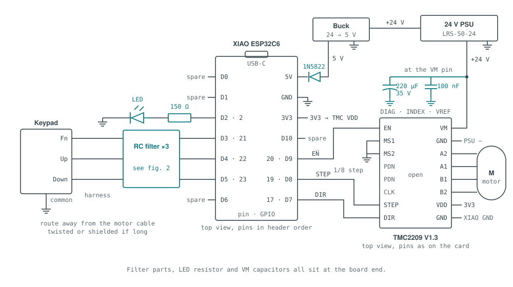
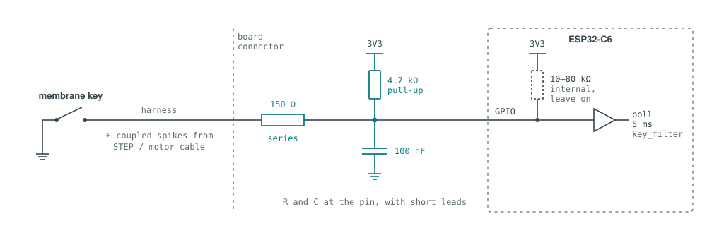

# Hardware & Wiring — DFR-RollerBlinds

**Revision 2 hardware** (2026-07-25): a Seeed XIAO ESP32C6 controller and
a BIGTREETECH TMC2209 V1.3 stepper driver. They replace the original
DFRobot FireBeetle 2 ESP32-C6 and DRV8825. The new driver was selected
for the StealthChop2 silent-chopping mode of the TMC2209. The vendor
manual (bigtreetech/BIGTREETECH-TMC2209-V1.2 on GitHub, which has the
same design as this module) says that this mode **is the factory
default**. It needs no wiring. Only one setting needs attention: refer to
[Setting Vref (current limit)](#setting-vref-current-limit) below. The
bring-up notes of the original FireBeetle/DRV8825 (breadboard debugging,
the `SLEEP̅`/`RESET̅` trap) do not apply now. They are in the git history.

This is the full wiring reference for the current hardware. It was
compared with the TMC2209 pin-designation manual of BTT (their V1.2 and
V1.3 modules have the same 16-pin header layout). Some values are not
yet confirmed on the bench. For example, the motion speed under real
load is not measured. Also, the D-number → GPIO mapping of the XIAO can
be different on your board. This document identifies these values
clearly. Do not
accept them as correct until you measure them.

## Wiring diagram

This diagram shows one full unit on the **v2.4.0 pin map** (Fn D3,
LED D2, D6 spare). It includes the keypad RC front end, the VM bulk
capacitor and the 1N5822 backfeed diode. The parts in teal were added in
September 2026. The TMC2209 and the XIAO are shown from the top, with
the pins in their physical header sequence.



This diagram shows one keypad line. Fn, Up and Down each have the same
wiring:



**The repo copy is the master.** `docs/wiring/wiring-diagram.html` is the
full page. It has the two diagrams, the parts table, the XIAO header
table, the list of missing items, and the checks for rewiring and after
installation. Open it in a browser. The two SVGs above come from this
page. To make a change:

1. Change the HTML.
2. Extract the SVGs again.
3. Commit them with the wiring change that they show.

A copy that you can share is published as a private claude.ai artifact
(https://claude.ai/artifact/XzdV31M5Czvb5AnbZ7gtDR). After a change,
publish it again from the repo file.

## Bill of materials

| Part | Role |
|---|---|
| Seeed XIAO ESP32C6 (`seeed_xiao_esp32c6`) | Controller. Only 11 GPIOs are available on the header (D0–D10). The design uses 7 GPIOs and keeps 1 in reserve (refer to [GPIO summary](#gpio-summary-srcmainc)). Thus 3 are spare. |
| External antenna: **WiFi antenna 2.4–5.9 GHz, 3 dBi, 2 W, U.FL/IPEX connector** | Zigbee antenna. It is mandatory from firmware v2.4.1, which sets the radio to the U.FL socket. It covers 2.4 GHz, which Zigbee uses. Refer to [Fitting the U.FL antenna](#fitting-the-ufl-antenna-v241). |
| 2HS60-1504JA05-020-03 bipolar stepper | Drive motor for the **larger** blinds: 1.8°/step (200 full steps/rev), 1.5 A/phase class, 60 mm body, 4 wires (2 coils) |
| 17HS4401 bipolar stepper | Drive motor for the **smaller** blinds: 1.8°/step, 1.7 A/phase class, 40 mm body, 4 wires. Its torque is lower than the 2HS60 (approximately one half to two thirds). It needs a **different Vref**: refer to [Setting Vref](#setting-vref-current-limit). Its lower torque sets the `CRUISE_US` limit for the full fleet. Refer to [Motion speed tuning](#motion-speed-tuning). |
| BIGTREETECH TMC2209 V1.3 breakout | Stepper driver. StealthChop2 silent chopping is the factory default (it needs no wiring). 1/8 microstep through pin strapping of `MS1`/`MS2`. This is the same resolution as before, so all the step-count calculations stay the same. It needs its own logic-supply pin (`VCC_IO`). The DRV8825 did not have this pin. Refer to the pin table below. |
| 3D-printed geartrain: housing + lid (left or right hand, mirror pairs), 12 T driver, 36/12 T compound, 60 T driven, shaft attachment ([`hardware/gearbox/`](hardware/gearbox/README.md)) | 1:15 reduction to the roller tube (module 1, 3:1 × 5:1) |
| Bearings for the geartrain: **1 × 61804-2RS1** (20×32×7) and **3 × 628/7-2Z** (8×14×5) | The output shaft and the three gear axes. Refer to [`hardware/gearbox/`](hardware/gearbox/README.md). |
| Mean Well 24 V DC PSU: **LRS-50-24 recommended** (LRS-35-24 is acceptable) for one unit | System supply. To use one PSU for many controllers, refer to [Multi-unit installations](#multi-unit-installations-shared-psu). |
| Mean Well **LRS-150-24** (24 V, 6.5 A, ~156 W): *optional, instead of the LRS-50-24 above* | One shared supply for **3 blind controllers**, instead of one PSU for each unit. For the sizing and the distribution wiring, refer to [Multi-unit installations](#multi-unit-installations-shared-psu). |
| Step-down buck regulator, 24 V → 5 V for the XIAO | The current builds use a **Mini560 Pro**. Rev 1 used a **Pololu D36V28F5** (5 V/3.2 A, VIN 5.3–50 V, as in the power-chain diagram below. This row said 2.5 A / 6–38 V before). The two regulators operate correctly. The Pololu is much more efficient at idle. Refer to [Idle power draw](#idle-power-draw). |
| Schottky diode, from the 5 V output of the buck to the 5V pin of the XIAO: **stocked part 1N5822** (3 A 40 V, DO-201AD, leads ~1.3 mm; ordered 2026-09-27). The 1N5817 and the SS14 are equally good and smaller. | It prevents current from USB VBUS through the buck in the reverse direction when only USB supplies the board. Refer to [Power chain](#power-chain) and [Troubleshooting](#motor-turns-with-24-v-off). |
| Membrane keypad: 2 arrow keys + function key | Local controls and the calibration UX |
| External status LED (on the face of the enclosure): **Kingbright L-7104SURC-E** + **150 Ω** (Yageo `MF0204FTE52-150R`) | Status indicator. This revision does not copy the status to the onboard LED. The external LED is the only status indicator. This makes a GPIO free on the smaller header of the XIAO (refer to [GPIO summary](#gpio-summary-srcmainc)). Refer to [LED wiring](#led-wiring). |
| VM bulk capacitor: **220 µF 35 V** electrolytic (100 µF 50 V is acceptable) | Across `VM`/`GND` of the TMC2209, at the pin. It is mandatory. Refer to [Power chain](#power-chain). |
| Keypad RC front-end, for each unit: **3 × 4.7 kΩ** (`RS-C-4K7-5%-0.5W`), **3 × 150 Ω** (`MF0204FTE52-150R`), **3 × 100 nF** (Vishay `K104K20X7RH5TL2`, 100 V X7R) | Noise immunity on the three key lines. Refer to [Keypad noise immunity](#keypad-noise-immunity-fit-to-every-unit). With the LED resistor, each unit has **four 150 Ω resistors**. |
| Multimeter | Necessary for the Vref, VMOT and 3V3-rail checks below. Do these checks. |

## Recommended bring-up order

The last time, all the parts were wired at the same time, and then the
debugging was difficult. Thus a usual bring-up took a long time. Use
this sequence. You can test each stage independently before you go to
the next stage:

1. **XIAO only.** Flash the firmware. Make sure that the serial boot log
   is correct (refer to `DEVELOPER_GUIDE.md`). Do not connect other
   hardware yet.
2. **Keypad.** Wire the three keys and verify them (procedure below)
   before you work on the motor driver.
3. **TMC2209 logic pins only** (no motor and no VM yet). Wire
   `STEP`/`DIR`/`EN̅` and the mode-select pins (`MS1`/`MS2`, both to GND,
   as in the table below). Connect **`VCC_IO` to the 3V3 of the XIAO**.
   Do this step: the digital core of the driver does not operate without
   it. Make sure that `EN̅` changes as the firmware commands.
4. **TMC2209 power and Vref**, with the motor still disconnected. Set the
   current limit (new formula below). **Do not use the old DRV8825 Vref
   value again.**
5. **Motor.** Connect the coils last, when VM is already at the correct
   voltage.
6. **Full power chain** (24 V PSU + step-down to the XIAO) together.

## Power chain

```
24 V PSU (LRS-50-24) ──┬─── TMC2209 VM  (+ 220 µF 35 V electrolytic across VM/GND,
                        │                  close to the driver — non-negotiable
                        │                  spike protection; optional 100 nF
                        │                  ceramic in parallel)
                        │
                        └─── Step-down regulator (5 V / 3.2 A, VIN 5.3–50 V)
                                     │
                                     └─── 1N5822 Schottky (anode at buck,
                                          cathode/band at XIAO) ── XIAO ESP32C6 5V pin
                                                                          │
                                                  USB VBUS (when plugged) ┘
```

- 24 V goes directly to the **VM** pin of the TMC2209. The
  **electrolytic capacitor of 100 µF or more across VM/GND** is
  mandatory. Install it near the driver. Without it, transients of the
  motor current can increase VM sufficiently to damage the driver. (The
  V1.3 module of BTT accepts 4.75–28 V on VM. Thus 24 V has a large
  margin in the two directions.)
- **Capacitor selection:** the stocked part is **220 µF 35 V**.
  **100 µF 50 V** also satisfies the 100 µF requirement, and you can use
  it if it is available.
  - Use a rating of **35 V or more**. 24 V on a 25 V part gives no margin
    for the spikes that the capacitor must absorb.
  - **WARNING: Make sure that the polarity is correct.** The stripe
    identifies the negative lead, which goes to GND. An electrolytic
    capacitor installed in reverse on a 24 V rail can vent.
  - Optional: install a 100 nF ceramic capacitor (`K104K20X7RH5TL2`,
    100 V rating) in parallel. It absorbs the fast edges that are too
    fast for the electrolytic capacitor.
- The same 24 V rail supplies a step-down regulator that makes 5 V for
  the 5V pin of the XIAO. The peak current of the ESP32-C6 is much less
  than 1 A. Thus the margin is large.
- **A Schottky diode is necessary in series from the 5 V output of the
  buck to the 5V pin of the XIAO** (anode at the buck, cathode/band at the
  XIAO). The stocked part is the **1N5822** (ordered 2026-09-27). A
  1N5817 or an SS14 does the same work in a smaller body.

  When a USB cable is connected, USB VBUS also supplies the 5V pin of the
  XIAO. Without a blocking diode, current then flows in the reverse
  direction through the buck. On bench3, on 2026-09-26, USB only (24 V
  off) put 4.47 V on the `VM` of the driver. This voltage was sufficient
  to turn the motor without power on the 24 V rail. Refer to
  [Troubleshooting: Motor turns with 24 V off](#motor-turns-with-24-v-off).

  **Until you install the diode**, do not connect the two supplies at the
  same time. Use one of these methods:
  - Flash and do bench tests with USB only and the motor disconnected.
  - Operate installed units on 24 V only.
  - To use USB and 24 V together, disconnect the wire from the buck 5V
    to the XIAO 5V for that session. Keep the grounds connected. (For
    example, use this method to monitor the serial log during a real
    move.)
- **Installing the 1N5822:**
  - **Orientation:** the **band is the cathode**. It goes toward the 5V
    pin of the XIAO. The end without a band (anode) goes to the 5 V
    output of the buck. If the diode is installed in reverse, the XIAO
    gets no power from the buck. This causes no damage, but the XIAO does
    not start on 24 V only.
  - **The leads are ~1.3 mm** (DO-201AD body). This is thicker than a
    standard 1 mm perfboard hole. Make the holes larger with a
    1.3–1.5 mm drill. Alternatively, install the diode flat and solder the
    leads to pads or directly into the wire joint, with heat-shrink
    sleeve on it.
  - **Voltage drop:** ~0.3–0.4 V at the current of the XIAO (much less
    than 0.5 A). Thus the 5V pin gets ~4.6 V from the buck. This voltage
    is satisfactory for the 3.3 V regulator of the XIAO. The reverse
    leakage at 5 V or less is very small.
  - **Check after installation**, with the motor disconnected. Measure
    to GND with a meter:
    1. **24 V only:** the 5V pin of the XIAO is ≈ **4.6 V**, the 3V3 pin
       is ≈ **3.3 V**, and the XIAO starts (LED pattern). If the 5V pin
       is near 0 V, the diode is in reverse or does not conduct.
    2. **USB only (24 V off):** the `VM` of the driver is ≈ **0 V** (it
       was 4.47 V without the diode). If it is more than ~0.5 V, USB
       still gets to the buck. Check the orientation of the diode. Make
       sure that no wire goes around it.
    3. Only after these checks, operate with USB and 24 V together.
- **One common ground.** Connect these grounds together: PSU −, the two
  GND pins of the TMC2209 (usually there are two: one on the power side
  and one on the logic side), the ground of the step-down regulator, and
  the GND of the XIAO. If they are not connected, the logic signals have
  no reliable 0 V reference. The behavior then becomes erratic, and it
  is difficult to find the cause.
- At the current limit of the driver (~1.2 A/phase, refer to
  [Vref](#setting-vref-current-limit) below), install the heatsink of the
  TMC2209. Make sure that the enclosure gives airflow around the driver.
  The TMC2209 has a built-in thermal shutdown (the DRV8825 did not). Thus
  a thermal problem causes throttling or cutout, not damage. But prevent
  it, and do a thermal soak check on the bench (refer to
  `DEVELOPER_GUIDE.md`).
- **CAUTION: Never connect or disconnect the motor connector while VM
  has power.** The inductive spike that this causes is one of the most
  usual causes of damage to a stepper driver. First, remove the power
  from VM (or from the full 24 V rail).

### Idle power draw

These values were measured on the 24 V rail with the device at idle
(calibrated, joined, not moving):

| Build | Idle draw | Power |
|---|---|---|
| Rev 1 — FireBeetle 2 + DRV8825 + Pololu buck | ~8 mA | ~0.19 W |
| Rev 2 — XIAO + TMC2209 + Mini560 Pro buck | ~25 mA | ~0.6 W |

This is approximately 3 times more. **It is accepted. It is not a
problem.** These units use mains power. ~0.4 W for each unit is
approximately 3.5 kWh each year, and less than 2 W for three units. The
value is recorded here for two reasons: it is useful for PSU sizing, and
the cause is important if a future revision does not use mains power.

**Three items changed at the same time**: the MCU board, the stepper
driver and the buck regulator. Thus the cause of the increase is not yet
known.

The most probable cause is the **buck**, not the driver. A low quiescent
current is a main feature of the Pololu regulators, and some regulators
of that family use a power-save mode at light load. Mini560-class
modules are low-cost synchronous bucks that are designed to supply
current, not to idle. They frequently have a power LED that is always
on, and they use fixed-frequency PWM without a light-load burst mode.
The real load is approximately two hundred mW. At this load, a regulator
with ~10 mA of its own quiescent current at 24 V uses more power than
the circuit that it supplies. At this load, the difference between these
parts is much larger than their efficiency curves at rated load show.

The TMC2209 is a possible second cause. When VM has power, it keeps its
internal oscillator, its charge pump and its digital core (supplied by
`VCC_IO`) on. `EN̅` disables only the *output stage*, not the chip. The
TMC2209 also has no separate sleep pin. The DRV8825 had `SLEEP̅`.

**To find the cause** (not done yet: no Pololu was in stock on
2026-08-08), measure the 24 V rail three times. Add one item each time:

1. The buck only, with nothing on its output.
2. The buck and the XIAO, with the VM of the driver disconnected.
3. All the parts.

If the buck alone causes most of the difference, look for a power LED on
the module before you replace it. Usually you can lift a resistor or cut
a trace to get a few mA back.

## Multi-unit installations (shared PSU)

Many controllers can use one larger 24 V supply, instead of one PSU for
each blind. This section gives the sizing, the distribution wiring and
the protection for that installation. All the other parts of this
document (the TMC2209 wiring, Vref, keypad and LED of each unit) do not
change. They apply in the same way to each unit.

### Sizing the shared PSU

Start from the recommendation for one unit (LRS-50-24, 35–50 W). It
already has a large margin for the real current of one axis. Two
conditions cause most of that current, and the two stay small:

- **Idle:** between moves, the output stage of the TMC2209 is disabled
  (`EN̅` high). Thus the idle current of each axis is small: **~25 mA at
  24 V (~0.6 W), measured** on rev 2 (refer to
  [Idle power draw](#idle-power-draw)). Three units at idle use less than
  2 W. This is much less than the rating of the supply.
- **Moving:** the current limit of the TMC2209 limits the motor to
  ~1.2 A/phase. But the driver chops the 24 V bus down to the voltage
  that the coil needs. Thus at our low cruise speed (~6 rev/s at the
  motor shaft), the current on the **bus side** is much lower than the
  coil current. It is a few watts for each axis. A simple calculation of
  24 V × 1.2 A gives a value that is too high.

For **3 units**, a **Mean Well LRS-150-24** (24 V, 6.5 A, ~156 W real
maximum) has a large margin. Use an intentionally pessimistic estimate: the
three units move at the same time, and each axis uses much more current
than expected. The result is still much less than the rating of the
supply. A
large load on this supply occurs only if the three motors **stall** at
the same time near their current limit. Even then, a margin stays (the
Mean Well LRS series also accepts short overload peaks above the rated
value).

**Do not trust only the estimate. Measure the current.** On one unit
that already operates, put a multimeter (or, better, a clamp meter) on
the 24 V feed while the unit moves. Measure again while you
intentionally stall the motor against a hard limit. Thirty seconds of
measurement changes "should be fine" to "measured fine". It also gives
you the real value if you install more than 3 units in the future.

### Distribution wiring

Use a star topology from the shared PSU. Each unit has its own pair of
feeder wires to the supply. Do not use a daisy chain from one unit to
the next. In a daisy chain, the current of a downstream unit also flows
through the wiring and connectors of the upstream unit. This makes the
voltage-drop and fuse calculations more difficult, with no advantage:

```
                    ┌─── (fuse) ──── Blind 1 (VM / GND)
Mean Well LRS-150-24 ├─── (fuse) ──── Blind 2 (VM / GND)
   24 V / 6.5 A       └─── (fuse) ──── Blind 3 (VM / GND)
```

- **Install a fuse (4 A slow-blow) on each branch.** When one supply
  feeds many installations, a wiring fault or a locked rotor on one
  blind must not cause a brownout or damage on the other branches. In
  the design for one unit, this was not a problem (there was nothing
  else to protect). It is important when many units use one source.

  Use a 4 A slow-blow fuse. Do not use the ~2 A fast-blow fuse that this
  document gave before. The carrier board has its own 3 A slow-blow
  input fuse and 220 µF of bulk capacitance. A 2 A fast-blow branch fuse
  opens on the inrush current of that capacitor before the fuse of the
  board opens. Refer to
  [docs/research/input-protection.md](docs/research/input-protection.md).
- Each unit still needs its own **electrolytic capacitor of 100 µF or
  more across VM/GND at the driver** (refer to [Power chain](#power-chain)),
  also with a shared supply. Each driver needs this spike protection. The
  bulk capacitance of the shared PSU does not replace it.
- **The logic ground stays local to each unit.** The three controllers
  are independent Zigbee nodes, with no wired link between them. Only
  the 24 V return and the XIAO/TMC2209 grounds of the *same unit* must be
  common (as in [Power chain](#power-chain)). You do not need a shared
  logic-ground bus between the units.

### Wire gauge (voltage drop)

This table is for runs of **5 m** in one direction (10 m in total,
because the current also returns through GND). It uses
`Vdrop = I × ρ × (2×L) / A` with `ρ ≈ 0.0175 Ω·mm²/m` (copper). The usual
guidance is a drop of less than ~3–5 %. A few hundred millivolts less
than 24 V is not a problem for the driver (the VM minimum is ~4.75 V):

| Conductor | Drop @ 1.5 A (motor's rated current — a safe sizing figure) | Drop @ 2.5 A (pessimistic worst case) |
|---|---|---|
| 0.5 mm² (~AWG 20) | 0.53 V (2.2 %) | 0.88 V (3.6 %) |
| **0.75 mm² (~AWG 18) — recommended** | 0.35 V (1.5 %) | 0.58 V (2.4 %) |
| 1.0 mm² (~AWG 17) | 0.26 V (1.1 %) | 0.44 V (1.8 %) |
| 1.5 mm² (~AWG 16) | 0.18 V (0.7 %) | 0.29 V (1.2 %) |

Use **0.75 mm² (18 AWG) or thicker** for each branch. The drop is much
less than 2.5 %, also at the pessimistic current. Its ampacity covers
the 4 A branch fuse with a margin. At 5 m, the wire gauge is necessary
for mechanical strength (thin wire breaks easily at the connectors), not
for electrical reasons. If your real runs are much longer, calculate the
table above again.

## TMC2209 complete pin-by-pin wiring

The TMC2209 V1.3 breakout is a 16-pin module (two columns of 8 pins, one
on each side of the chip). It also has `DIAG`/`INDEX`/`VREF` as separate
pins near the top, and the current-limit trimpot. The pin names below
come from the TMC2209 pin-designation manual of BTT (their V1.2 and V1.3
modules have the same layout). But **read the silkscreen on your board**
before you wire it, because clones are different.

> **Measured on these units (2026-11-06,
> [Measure the physical XIAO and TMC2209 modules](https://github.com/linosteenkamp/DFR-RollerBlinds/issues/13)):**
> the pin card that came with the modules shows `PDN`/`PDN`/`VDD`/`VM`,
> as in the table below. The V1.3 files that BTT publishes
> (`bigtreetech/BIGTREETECH-Stepper-Motor-Driver`, `TMC2209/V1.3`) give
> different names to the same pins in the same positions: `RX`/`TX`
> (the first `PDN`, pin 4, carries UART), `VIO` and `VS`. **The `DIAG`
> row has two pins that point down, next to `EN`, 5 mm long.** The first
> pin (2.54 mm from `EN`) is **`VREF`**, and it has continuity with the
> trimpot wiper. The second pin (5.08 mm) is **`DIAG`**. `INDEX` has no
> downward pin. Other measurements: board 1.5 mm, header pins 8.5 mm
> below the board, tallest part on the bottom 1 mm, heatsink
> 9 × 9 × 12 mm. For more information, refer to
> [docs/research/module-footprints.md](docs/research/module-footprints.md).

**Physical layout** (top view, with the trimpot and
`DIAG`/`INDEX`/`VREF` at the top edge), as shown on the pin card that
comes with the V1.3 module:

```
            DIAG · INDEX · VREF
          ┌───────────────────┐
  EN    ──┤ 1              16 ├── VM      ← 24 V (+ 220 µF, 100 nF)
  MS1   ──┤ 2              15 ├── GND     ← PSU −
  MS2   ──┤ 3              14 ├── A2  ┐
  PDN   ──┤ 4              13 ├── A1  ┘ coil A
  PDN   ──┤ 5              12 ├── B1  ┐
  CLK   ──┤ 6              11 ├── B2  ┘ coil B
  STEP  ──┤ 7              10 ├── VDD     ← XIAO 3V3  (= VCC_IO)
  DIR   ──┤ 8               9 ├── GND     ← XIAO GND
          └───────────────────┘
```

**The card calls the logic-supply pin `VDD`. The manual of BTT and this
document call it `VCC_IO`.** It is the same pin: in the right column, the
second pin from the bottom, next to the logic-side `GND`. All the logic
signals are in the left column. All the power and motor pins are in the
right column. The two `GND` pins are in the right column, at the top
(power) and at the bottom (logic). The pin numbers above are the numbers
of this document, for reference only. The module does not show them.

| TMC2209 pin | Wire to | Notes |
|---|---|---|
| `EN` (ENABLE) | XIAO **D9 / GPIO20** | Active-low enable, the same convention as the DRV8825 that it replaces. The firmware sets it high (disabled) at idle, and low only during a move. |
| `MS1` | **GND** | ┐ |
| `MS2` | **GND** | ├ `MS2:MS1 = GND:GND` → **8 microsteps (1/8)**. This is the same as the old DRV8825 setting. Thus `1600 microsteps/motor-rev` / `24 000 microsteps/output-rev` and all the derived constants (ramp tuning, `MIN_SPAN_STEPS`, the calibration span calculations) do not change. |
| `PDN` (2 adjacent pins, silkscreen `PDN`) | Do not connect the two pins | UART pin. A factory bridge connects it internally to the first of the two positions. This revision does not use UART. It uses the plain STEP/DIR standalone mode, the same control model as the DRV8825 that it replaces. If a future revision uses UART (register-based current control, StallGuard, etc.), use **D10 / GPIO18** on the XIAO. It is next to `EN` on D9, so it is in the same corner of the header as the other driver wires. |
| `CLK` | Do not connect | The default is the internal oscillator. An external clock is not necessary. |
| `STEP` | XIAO **D8 / GPIO19** | Step pulse train |
| `DIR` | XIAO **D7 / GPIO17** | Direction level, set before each move |
| `VM` | 24 V PSU **+** | Also the capacitor of 100 µF or more to the adjacent GND, directly at the pin |
| `GND` (power side, next to VM) | 24 V PSU **−** | |
| `A1`, `A2` | Motor coil **A** (one pair) | Refer to the coil identification below. On the header, `A2` is above `A1`. |
| `B1`, `B2` | Motor coil **B** (the other pair) | |
| `VCC_IO` (silkscreen **`VDD`** on the V1.3 pin card) | **XIAO 3V3** | **The DRV8825 did not have this pin.** The DRV8825 made its logic reference from VMOT. The digital core of the TMC2209 needs its own 3–5 V logic supply on this pin. Without it, the driver does not recognize `STEP`/`DIR`/`EN`. Connect it to the 3.3 V rail of the XIAO (not to 5V). Then the logic threshold agrees with the voltage of the XIAO GPIOs. |
| `GND` (logic side, next to `VCC_IO`) | XIAO GND | Common ground. Refer to the power chain note above. |
| `DIAG`, `INDEX`, `VREF` | Do not connect `DIAG`/`INDEX`. `VREF` is the trimpot test point. | `DIAG`/`INDEX` are stall-detection and step-position outputs. This firmware does not use them (no closed-loop features; spec §11, out of scope). Measure the current limit at `VREF`. Refer to the section below. |

**The external header of this module has no `SPREAD` pin.** The
selection between StealthChop2 and SpreadCycle is an internal solder pad
on the PCB (silkscreen `SPRE`, on the bottom). You cannot get to it from
the header. The manual of BTT says that **the factory bridge selects
StealthChop2 ("mute mode")**. This is the reason for the new driver. You
do not need to wire it. Do not touch that solder pad. If you change the
bridge, the driver selects SpreadCycle, which is loud.

### ⚠️ The two motors' cables are NOT interchangeable

**Found on the bench on 2026-08-03.** The 2HS60 and the 17HS4401 use a
different lead sequence in their connectors. Thus a cable made for one
motor gives **incorrect coil pairs** on the other motor: one wire from
coil A and one wire from coil B go to the same driver terminal pair. The
symptom is the same as the incorrect-pair symptom below: a buzz,
vibration without rotation, or weak, rough motion. It looks like a
defective driver or a speed problem, but it is neither.

These are the results for a build with many units:

- **Put a label with the motor type on each motor cable** during
  assembly. The connectors of the two types fit together, and nothing
  physical shows that they must not.
- **When you replace a motor, replace the cable.** To replace a defective
  17HS4401 with a 2HS60 (or the opposite), you need the matching cable,
  not only the matching Vref.
- **When you do not know where a cable came from, verify the pairs with
  a continuity check.** Do not use the connector position. Use the
  procedure below.

The cable and the [Vref](#setting-vref-current-limit) of each motor are
two independent items that must agree with the installed motor. The two
show as motion faults, and the firmware cannot see either one.

### Coil identification

The 2HS60-1504JA05-020-03 has 4 leads that make 2 coils. Before you wire
it, find the pairs with a continuity check. Set the multimeter to
resistance or continuity. Disconnect the motor from all other items.

1. Measure the resistance between each pair of the 4 leads.
2. Two pairs show a few ohms (the coil windings). The other four pairs
   show open (infinite).
3. One low-resistance pair → `A1`/`A2`. The other pair → `B1`/`B2`. The
   polarity in a pair is not important for correct operation. If you
   interchange A1↔A2 (or B1↔B2), the field of that coil reverses. This
   causes no visible change, or it reverses the direction of the motor.
   If the motor turns in the "incorrect" direction after you wire it, do
   not rewire the coils. Use the firmware setting `motor_reversed`
   (refer to [Direction check](#direction-check)). You can reverse this
   setting without a change to the connector.
4. **Incorrect pairs** (for example, one wire from coil A and one wire
   from coil B on the same terminal pair) are the condition that you
   must prevent. They usually cause a buzz, vibration without rotation,
   or motion that is much weaker and rougher than with correct pairs.

### GPIO summary (`src/main.c`)

The XIAO ESP32C6 has only 11 GPIOs on its header (`D0`–`D10`). This
revision uses 7 GPIOs for the same signals as before. It does not copy
the status to the onboard LED. The XIAO has no user LED on a header pin
that is easy to probe. Also, the external LED was always the primary
indicator. Thus 4 GPIOs are spare.

The assignments agree with the **physical layout of the implementation
board**. The three driver signals are together on `D7`–`D9` at one end
of the header. The 3-pin harness of the keypad is on `D3`–`D5` at the
other end. The LED is on `D2`. This grouping is the reason for the pin
selection. Each harness goes to adjacent header pins, and you can solder
it directly without jumpers.

**The pin map changed on 2026-09-25 (v2.4.0 firmware): Fn D6 → D3, LED
D3 → D2.** Before, the keypad was on `D4`–`D6`, and thus Fn was on
GPIO16. In the C6 package, that pin is next to GPIO17 of DIR. On the
carrier board, the two traces went into the same corner as the STEP line,
which operates at kilohertz frequencies. Now Fn is on the other side of
the header from the spare `D10`, and `D6` is empty as a buffer. **You
must change the firmware and the wiring together.** Refer to
[Rewiring for the v2.4.0 pin map](#rewiring-for-the-v240-pin-map).

**Physical layout** (top view, USB-C at the top), from the
[XIAO ESP32C6 getting-started pin table](https://wiki.seeedstudio.com/xiao_esp32c6_getting_started/)
and the [pin-multiplexing page](https://wiki.seeedstudio.com/xiao_pin_multiplexing_esp32c6/)
of Seeed, with the v2.4.0 assignments of this project:

```
                          ┌──[ USB-C ]──┐
   spare      GPIO0   D0 ─┤ •         • ├─ 5V              ← buck 5 V out
   spare      GPIO1   D1 ─┤ •         • ├─ GND             ← common ground
   LED        GPIO2   D2 ─┤ •         • ├─ 3V3             → TMC VDD, key pull-ups
   Fn         GPIO21  D3 ─┤ •         • ├─ D10  GPIO18     spare (PDN_UART later)
   Up         GPIO22  D4 ─┤ •         • ├─ D9   GPIO20     EN̅
   Down       GPIO23  D5 ─┤ •         • ├─ D8   GPIO19     STEP
   spare      GPIO16  D6 ─┤ •         • ├─ D7   GPIO17     DIR
                          └─────────────┘
```

The alternative functions from Seeed, for information: D0–D2 can be ADC
inputs (and LP_GPIO). D4/D5 are the default I²C SDA/SCL. D6/D7 are UART0
TX/RX. D8/D9/D10 are SPI SCK/MISO/MOSI. This design uses none of those
peripherals. You can use the SPI pins for `STEP`/`EN̅`, because they are
plain GPIOs when SPI is not configured.

**These items are not on the header.** Thus you cannot wire to them:

- the JTAG pads on the back (MTMS GPIO4, MTDI GPIO5, MTCK GPIO6,
  MTDO GPIO7)
- BOOT on GPIO9
- the onboard user LED on GPIO15
- the RF switch on GPIO3 (switch power) and GPIO14 (selection of the
  onboard or the U.FL antenna)

 The battery pads are on the back: negative near the
`D8` silkscreen, positive near `D5`.

**The firmware controls the RF switch (from v2.4.1): GPIO3 low enables
it, and GPIO14 high selects the U.FL antenna.** Up to v2.4.0, nothing set
these pins, and thus the radio operated badly. Thus **each unit must
have a U.FL antenna** before it runs v2.4.1 or later. Refer to
[Fitting the U.FL antenna](#fitting-the-ufl-antenna-v241). Do not use
GPIO3/GPIO14 for a different function.

| Signal | XIAO pin | GPIO | Notes |
|---|---|---|---|
| `STEP` | D8 | GPIO19 | Pulse train from the GPTimer ISR of `motion.c` |
| `DIR` | D7 | GPIO17 | Level set before each move. `motor_reversed` reverses its meaning. |
| `EN̅` | D9 | GPIO20 | High = driver **disabled**. The firmware sets it low only during moves. |
| Keypad Up | D4 | GPIO22 | Internal pull-up. (The silkscreen of the XIAO also shows this pin as I²C SDA. This design does not use I²C. The pin is a plain GPIO input.) |
| Keypad Down | D5 | GPIO23 | Internal pull-up. (It is also I²C SCL, which this design does not use.) |
| Keypad Fn | D3 | GPIO21 | Internal pull-up. Before v2.4.0, it was D6/GPIO16. |
| External status LED | D2 | GPIO2 | Through a series resistor to the LED, then the LED to GND. It is the only status indicator in this revision. There is no copy on the onboard LED. History: D2 until 2026-08-08, then D3 for the board layout, then D2 again in v2.4.0 to make D3 free for Fn. GPIO2 is not a strapping pin on the C6. |
| *(spare)* | D0, D1, D6, D10 | GPIO0, GPIO1, GPIO16, GPIO18 | Not used. If you connect `PDN_UART` for a future TMC2209 UART upgrade, use `D10`. It is next to `EN` on D9, and thus the driver harness stays in one corner. |

**`D6`/`D7` are the default UART0 TX/RX pins of the ESP32-C6**, and this
design uses `D7` for `DIR`. (`D6` is spare since v2.4.0. Before, it
carried Fn.) This is safe *only* because the console uses the built-in
USB-Serial-JTAG, not UART0. `sdkconfig.defaults` sets
`CONFIG_ESP_CONSOLE_UART_DEFAULT=n` / `CONFIG_ESP_CONSOLE_USB_SERIAL_JTAG=y`.
The result is `CONFIG_ESP_CONSOLE_UART_NUM = -1`.

> **CAUTION:** Do not set the console to UART0 again before you move
> `DIR` to a different pin. The console on UART0 would drive the `DIR`
> line.

The header of the XIAO has none of the strapping pins of the ESP32-C6
(GPIO4/5/8/9/15). Thus no strapping-pin caution is necessary here. This
is simpler than the FireBeetle, where the onboard-LED copy had to share
a strapping pin intentionally.

**The D-number → GPIO mapping is verified on hardware.** `tools/pinwalk`
verified all the pins that were in use on 2026-08-02 (with D2 and D6).
The LED on D3/GPIO21 was verified on 2026-08-08. The v2.4.0 combination
(Fn D3/GPIO21, LED D2/GPIO2) ran on `bench3` on 2026-09-26. *(An earlier
revision of this paragraph said that the mapping was not yet checked.
That was not up to date.)* The silkscreen shows only D-numbers, never
GPIO numbers. Thus run `tools/pinwalk` on each board from a new batch.
Do not trust the table.

## Setting Vref (current limit)

**Each unit has its own Vref, and the value depends on the motor of
that unit.** The fleet uses two motors (refer to
[Bill of materials](#bill-of-materials)). Set the current to 80% of the
rated phase current of the motor. **The formula and the voltage are
different from the DRV8825.** Do not use the old 0.6 V value again.

The manual of BTT gives the formula (0.11 Ω sense resistors, standard on
this module):

```
Irms = 325mV / (Rsense + 20mΩ) × 1/√2 × (Vref / 2.5V)
     = 325mV / 130mΩ × 1/√2 × (Vref / 2.5V)
     ≈ Vref × 0.71        (equivalently: Vref ≈ Irms × 1.41)
```

| Motor | Blinds | Rated | Target (80%) | **Vref** |
|---|---|---|---|---|
| 2HS60-1504JA05-020-03 | larger | 1.5 A/phase | 1.2 A | **1.69 V** |
| 17HS4401 | smaller | 1.7 A/phase | 1.36 A | **1.92 V** |

If you set a 17HS4401 unit to 1.69 V, the current is too low (only ~71%
of its rating). The motor then loses torque that it needs. This occurred
on the bench on 2026-08-02, and it caused a stall. Compare the rating of
your motor with its own datasheet. Do not trust the table, because there
are different versions of the 17HS4401.

The 17HS4401 has a 42×42×**40 mm** body. The 2HS60 has a 60 mm body. The
17HS4401 has less thermal mass. Thus it becomes warm more quickly, also
at its own correct current. Touch it to check the temperature during the
thermal soak.

**The board does not come with that value.** The manual of BTT says that
the factory Vref is 1.2 V ±0.1 V (≈0.9 A). Thus you must adjust the
trimpot.

Procedure. Keep the **motor disconnected**:

1. Supply power to the board from the 24 V rail (VM on). `EN`/`MS1`/`MS2`/
   `VCC_IO` must already be wired as in the table above. **`VCC_IO` is
   also important here.** Without it, the digital core of the chip does
   not operate, and the Vref reading is not correct.
2. Set a multimeter to DC volts.
3. Measure between the **`VREF` test point** and **GND** (a GND pin near
   it on the breakout, not the motor connector). Refer to the silkscreen
   of your board for the position of the test point.
4. Turn the trimpot carefully until the meter shows **≈1.69 V**. (The
   valid range for this board is 0.2–2.2 V. Thus 1.69 V has a margin on
   the two sides.)
5. Only after this step, connect the motor.

Do this check again after you replace a driver. The trimpot position is
different on each board.

## Keypad wiring

Membrane keypad with three keys (Up / Down / Fn):

```
Membrane keypad                                  XIAO ESP32C6
┌──────────┐
│ Common ──┼──────────────────────────────────── GND
│ Fn     ──┼──── 150 Ω ──┬──────────────────────  D3 / GPIO21
│ Up     ──┼──── 150 Ω ──┼─ (same per line) ────  D4 / GPIO22
│ Down   ──┼──── 150 Ω ──┼─ (same per line) ────  D5 / GPIO23
└──────────┘             │
                 each line's node, at the XIAO end:
                   node ── 4.7 kΩ ── 3V3
                   node ── 100 nF ── GND
```

One full channel:

```
key ── harness ──┤connector├── 150 Ω ──●── GPIO (internal pull-up left ON)
                                       │
                          3V3 ─ 4.7 kΩ ┤
                                       │
                                     100 nF
                                       │
                                      GND
```

Common goes to GND. The line of each key goes to its own GPIO. An
external 4.7 kΩ pull-up, in parallel with the internal pull-up, pulls
the line up. Thus the pin is HIGH at idle and LOW when you push the key.
Units built before the RC front-end have only the internal pull-up and a
direct wire. The firmware operates with the two versions. Refer to
[Keypad noise immunity](#keypad-noise-immunity-fit-to-every-unit).

The firmware debounce is now an integrator filter (`src/key_filter.c`).
It records an edge only after the level stays changed for a time. It
replaces the `debounce` module of `esp-zb-common`. That module only found
changes and did no debouncing. One sample with noise went through as a
full press and release. Because of this gap, a keypad harness that was
installed next to the stepper cable on an installed unit made false key
presses. These presses moved the blind from one end to the other without
a person. On an installed unit, the internal pull-up alone was not
sufficient. Thus external pull-ups and an RC filter are now standard.
Refer to
[Keypad noise immunity](#keypad-noise-immunity-fit-to-every-unit)
below.

**Find the common pin before you wire the keypad.** Do not identify it
from its position on the tail. The pinouts of membrane tails are
different between suppliers. The "common" is sometimes an end pin and
sometimes not. Set a multimeter to continuity. Hold one key down and
probe pairs of pins on the tail. The pin that has continuity for *each*
key (one key at a time) is the common. Connect that pin to GND. Connect
the other three pins: Fn→D3, Up→D4, Down→D5.

**A breadboard divides each row at the centre channel.** A jumper on the
incorrect half of a row, or in the adjacent row, does not look
incorrect. But that key then never operates. If one key never records a
press and the other two keys operate correctly, check this first. Refer
to [Troubleshooting](#troubleshooting) below.

### Verifying the keypad

Before you trust the wiring, use the serial monitor to make sure that
the three keys operate electrically:

```bash
pio run -e seeed_xiao_esp32c6_zigbee -t upload -t monitor
```

Push each key in sequence. Monitor the state changes through the
dispatcher (motion starts on a hold, an ACK flash on a tap when the
device is calibrated, etc.). For the full gesture reference, refer to
`DEVELOPER_GUIDE.md`. If a key causes no reaction, do not first assume
a firmware fault. From the first bring-up session, the most probable
cause is the wiring. Use the keypad checklist in
[Troubleshooting](#troubleshooting).

### Keypad noise immunity (fit to every unit)

An installed unit moved itself up and down six times in one night. The
keypad harness was next to the stepper cable. It coupled sufficient
noise onto the high-impedance lines (internal pull-up only) to make
false key presses. The firmware correction (the `key_filter` integrator
above) closes the software part of that gap. But with only the internal
pull-up, the lines are more sensitive to coupled noise than necessary.
These hardware changes are recommended for new builds, in sequence of
priority:

1. **External pull-ups to 3V3 on the three key lines, 4.7 kΩ or
   5.1 kΩ.** This is the largest improvement. It decreases the node
   impedance from ~45 kΩ (internal pull-up only) to ~4.3-4.6 kΩ. For the
   same coupled current, the coupled noise voltage becomes approximately
   10 times smaller. **The two values are satisfactory.** 5.1 kΩ gives
   9.8× and 4.7 kΩ gives 10.6×. This difference is much smaller than the
   effect of the cable length and routing. Use the value that you have.
   Do not order a part only for the nominal value. **Stocked (2026-09):
   4.7 kΩ 0.5 W carbon film.** It dissipates ~2 mW when you hold a key.
   Thus the 0.5 W rating only uses more board space.
2. **RC low-pass at the MCU pin**: **150-470 Ω** in series from the
   connector, and 100 nF from the pin to GND. **Stocked (2026-09): 150 Ω**
   (`MF0204FTE52-150R`, the same part as the LED resistor) and
   **100 nF 100 V X7R** (`K104K20X7RH5TL2`). Put the pull-up and the
   capacitor at the XIAO end, with short leads. Put the series resistor
   between the connector and that node.

   **Do not use 1 kΩ here.** (An earlier revision of this document said
   1 kΩ.) With a pull-up at the pin, the series resistor makes a divider
   when you push a key. Thus the line never gets to 0 V:

   ```
   V_low = 3V3 × Rs / (Rs + Rpu_combined)
   ```

   The guaranteed logic low of the C6 is 0.25 × VDD ≈ 0.83 V. With
   Rs = 1 kΩ and a combined pull-up of ~4.6 kΩ, the result is 0.59 V.
   This gives a margin of only ~0.24 V. Also, the specified range of the
   internal pull-up is large (usually given as 10-80 kΩ, not exactly
   45 kΩ). At the strong end, the combined value decreases to ~3.4 kΩ,
   and V_low increases to 0.75 V. This is near the threshold, and thus
   the temperature and supply drift become important. Rs = 220 Ω gives
   V_low ≈ 0.15 V and a large margin. The stocked **150 Ω gives 0.11 V**
   (0.15 V with the internal pull-up at the strong end of its range).

   A smaller Rs does not make the filter worse. The corner of the
   low-pass filter comes from the *pull-up* and the capacitor, not from
   Rs. 4.7 kΩ ∥ internal with 100 nF gives τ ≈ 0.43 ms. (After a
   release, the pin reads high ~0.6 ms later. This is much less than one
   5 ms poll.) A person cannot see this delay, but it stops coupled
   spikes. The real function of the series resistor is to protect the
   pin and to limit injected current. 150 Ω does this correctly. For
   spikes that come along the harness, it also makes an Rs·C low-pass
   (~10 kHz at 150 Ω) with the same capacitor.

   **Keep the internal pull-up enabled.** *(Corrected 2026-09-25. An
   earlier revision of this section said to change `keypad_init` to
   `GPIO_PULLUP_DISABLE` after the external parts were installed.)* All
   units use the same OTA image. Thus that change would also go to units
   that do not have the new parts. Their key lines would then float, and
   a floating line is the input that makes false presses. The internal
   pull-up has almost no cost. In parallel with 4.7 kΩ, even the strongest
   internal pull-up (10 kΩ) changes V_low only from 0.11 V to 0.15 V,
   against a threshold of 0.83 V. Examine this again only when all units
   in the fleet have the front-end.
3. **Keep the keypad harness away from the motor cable.** Use separate
   bundles. If they must cross, cross them at 90 degrees. Do not install
   them parallel and adjacent.
4. **Use a twisted or shielded keypad cable**, with a ground return
   next to the signals. Connect the shield to ground only at the MCU end.
5. **Fn moved from D6: done in v2.4.0** (Fn → D3, LED → D2). On D6, Fn was
   GPIO16. On the C6 package, this pin is next to GPIO17 of `DIR`. Its
   trace was in the same corner of the carrier board as `DIR` (D7) and
   `STEP` (D8, which switches at kilohertz frequencies with fast edges).
   *(On the XIAO header, D6 and D7 are on opposite sides of the board.
   They are not side by side. An earlier revision of this section said
   that they were "immediately adjacent".)* This change was done with the
   RC front-end. Thus each unit changes its hardware revision only one
   time.

**After installation**, with the unit on and idle, measure each of
D3/D4/D5 to GND. Each must show ~3.3 V. Then hold each key. The pin must
show ~0.1 V. If a line stays near 3.3 V when you push the key, the
signal does not get to the node. Check the harness and the solder joints
of the series resistor. Then hold Up and measure `EN̅` (D9). If it shows
0 V for the full hold, the full path operates.

For the full incident report and the analysis of the remaining risk
without these changes, refer to
`docs/superpowers/specs/2026-08-11-keypad-debounce-design.md`.

### Rewiring for the v2.4.0 pin map

v2.4.0 moves Fn from D6 to D3, and the LED from D3 to D2. **The firmware
and the wiring must agree.** The OTA image has no hardware revision.
Thus the device cannot know which wiring it has.

**Results when they do not agree:**

| Board wired for | Firmware | Result |
|---|---|---|
| old map (Fn D6, LED D3) | v2.4.0+ | **Unsafe.** Fn reads D3, which is the LED line. The pull-up pushes a few µA through the LED and 150 Ω to GND. Thus the pin stays near 1.5 V, between a valid low and a valid high. Fn can read as held, and after 3 s the device enters Calibration Mode. The LED stays off, and the real Fn key does nothing. |
| new map (Fn D3, LED D2) | v2.3.x or older | The old firmware drives D3 as the LED output, directly into the line of the Fn key. Thus when you push Fn, a pin that is driven high goes through 150 Ω to GND (~20 mA; the pin survives, but this is not correct). Fn does nothing, and the LED stays off. |

**Procedure, for each board:**

1. Remove the power (24 V off, USB disconnected).
2. Move the **LED** wire (with its 150 Ω) from D3 to **D2**.
3. Move the **Fn** wire from D6 to **D3**. If you do the two changes at
   the same time, install its RC front-end at the D3 end.
4. Keep D6 empty.
5. Flash or OTA **v2.4.0 or later** before you use the keypad.
6. Check: the LED shows its normal pattern. Hold Fn for approximately
   3 s at standstill, and the slow pulse of Calibration Mode starts.
   Hold Fn again to exit.

### Fitting the U.FL antenna (v2.4.1)

v2.4.1 enables the RF switch of the XIAO and connects the radio to the
U.FL socket. Earlier firmware did not drive the switch, and the board
received its neighbours very badly. These values were measured on
bench3, at the same position and with the same power, before and after:

| | v2.4.0 (switch undriven) | v2.4.1 (U.FL antenna) |
|---|---|---|
| LQI at the coordinator, 30 reads | mean 77 | mean 128.5 |
| Neighbours hearing the unit | 17, mean LQI 67 | 23, mean LQI 122 |
| Neighbours the unit can hear | 6 of 21 | 18 of 27, mean LQI 89 |

> **⚠️ CAUTION: Install the antenna before you push Update in z2m.** With
> v2.4.1 and no antenna, the radio transmits into an empty socket. This
> is probably worse than v2.4.0, and the unit can lose the network. You
> cannot update a unit over the air when it is not on the network. It
> then needs USB. For bench2 and blinds lounge side, install the antenna
> together with the [v2.4.0 rewiring](#rewiring-for-the-v240-pin-map).
> Then do the OTA one time.

1. Remove the power (24 V off, USB disconnected).
2. Push the U.FL plug straight down onto the socket on the XIAO until it
   clicks. It is fragile. Never push it on at an angle. Do not let the
   cable pull on it.
3. Put the antenna outside the enclosure or against its face, away from
   the motor, the driver and the 24 V wiring. Metal around the antenna
   makes it ineffective.
4. Apply power. Make sure that the boot log shows
   `RF switch: enabled, U.FL antenna`. After a few minutes, check its
   `linkquality` in z2m (refer to
   [Weak Zigbee link](#weak-zigbee-link--low-linkquality)).

## LED wiring

```
GPIO 2 (D2) ── resistor (150 Ω) ── LED anode
                                     LED cathode ── GND
```

There is one external status LED on the face of the enclosure: a
**Kingbright L-7104SURC-E**, 3 mm through-hole, Hyper Red (AlGaInP).
D2/GPIO2 (D3/GPIO21 before v2.4.0) drives it through a series resistor.
**This revision does not copy the status to the onboard LED.** The
external LED is the only status indicator. Thus you must wire it and make
it visible before you do bring-up stages after stage 1 (flash and serial
log only).

From the datasheet (Kingbright DSAB9908, Rev V.19A):

- `V_f` = 1.9 V typical / 2.5 V maximum at 20 mA (±0.1 V tolerance).
- **30 mA absolute maximum DC current.** Some retailer listings give
  "200 mA". That is a *pulsed* rating (1/10 duty cycle, 0.1 ms pulses),
  not a continuous rating. It does not apply to a status LED that is on
  continuously.
- 3100 mcd typical at 20 mA, which is very bright.

**Resistor: 150 Ω** (Yageo `MF0204FTE52-150R`, 1 %, 0.4 W). The
calculation uses the full tolerance band of `V_f`
(`R = (3.3V − V_f) / I_f`), not only a nominal value:

| `V_f` | Current |
|---|---|
| Worst-case low (1.8 V) | 10.0 mA |
| Typical (1.9 V) | 9.3 mA |
| Worst-case high (2.6 V) | 4.7 mA |

All values are 3–6 times less than the 30 mA rating. The luminous
intensity of this LED is approximately linear with current, and the part
is very efficient at 20 mA. Thus even at 4.7 mA, the LED is clearly
visible (~700 mcd).

If the LED is 2–4 m from the board, the wire adds resistance (24 AWG,
~0.0842 Ω/m, two directions because GND returns along the same
distance). This is 0.34–0.67 Ω, which is less than 0.5% of 150 Ω. Thus
the value does not change. For a run of that length, **put the resistor
at the LED end, not at the XIAO end**. The current limit is the same at
the two ends. But if the two wires touch along the run, a resistor at the
LED still protects the GPIO pin. A resistor at the board end has no
effect on that short circuit.

For the full LED pattern table (off / slow pulse / ~5 Hz / double flash
/ ack / error / identify), refer to the design spec §2. For the meaning
of each pattern during calibration, refer to
[DEVELOPER_GUIDE.md](DEVELOPER_GUIDE.md).

## Direction check

After the first power-up (or after you change the wiring), make sure
that the motor direction agrees with the keypad:

1. At standstill, **hold Up**. (At first, the device is not calibrated.
   Thus this is a hold-to-jog, not a tap. Taps do not move a device that
   is not calibrated.)
2. If the blind moves **up** (toward Open), the direction is correct. The
   check is complete.
3. If the blind moves **down**, the direction of the motor and gearing
   is reversed for this installation. To correct it, change
   `motor_reversed` in zigbee2mqtt (Mode attribute, `motor_reversed`
   expose). There is **no keypad gesture** for this. The Up + Down chord
   was removed in v2.3.0. (It erased the calibration after a 3 s hold
   without confirmation, and its latch could lock the keypad.) The
   device must be joined to change the setting.

This changes `motor_reversed` in NVS. All the stored step counts were
measured with the old direction. Thus this **erases the current
calibration**. After this, calibrate the device again (refer to
[DEVELOPER_GUIDE.md](DEVELOPER_GUIDE.md)).

## Motion speed tuning

> **Note:** the cruise speed is now a runtime setting for each unit,
> set from z2m (refer to "Resolved 2026-08-10" below). This section
> keeps the bench history of the `CRUISE_US` constant, because the
> torque results still apply.

Before, the cruise speed was a `#define` in `src/main.c` (`CRUISE_US`,
microseconds for each step at 1/8 microstep through the 1:15 reduction).
With the DRV8825, a lower `CRUISE_US` also made less noise. That result
applied only to the SpreadCycle-only chopping of that driver (a faster
movement through the resonance bands decreased the audible buzz).
StealthChop2 changes the type of noise fully.

**Bench result 2026-08-02:** at the inherited `CRUISE_US = 100`
(~2.4 s for each output revolution), the TMC2209 runs **quiet and smooth
without load**, with the motor uncoupled and Vref 1.69 V. No new tuning
is necessary for noise. This also confirms that the `SPRE` pad has its
factory StealthChop2 bridge and that the A/B coil pairs are correct.

**Torque under load is a different question, and the cause was the
current, not the speed.** With the motor coupled to the 1:15 reduction
and a real blind, a tap at `CRUISE_US = 100` started a move. Then the
motor vibrated at the same position. This was a stall. Hold-to-jog
continued to operate. This was the important sign. Jog uses
`JOG_CRUISE_US = 300`. Thus the only difference was the cruise speed.

The real cause was Vref. The bench unit had a **17HS4401 that was still
set to the 1.69 V of the 2HS60**. Thus its current was ~71% of its
rating. With Vref corrected to 1.92 V, 200 µs and **150 µs both give a
correct full travel in the two directions** (bench 2026-08-02, small
blind). `CRUISE_US = 150` is the tuned value.

100 µs was tested only with a current that was too low. Thus the real
stall point at the correct current is not measured. It can be below
150. Thus 150 gives at least the ~1.5 times margin of the rule of thumb,
and possibly more. **Before you decide that a stall means "too fast",
make sure that Vref agrees with the installed motor.**

> **CAUTION:** A stall makes the position incorrect, and the device does
> not know this. The step counting is open-loop. After the motor
> vibrates at one position, the stored position is not correct. Do a
> Re-home before you trust it. If a move stops at an unexpected
> position, first suspect lost steps. Then suspect the position logic.

### `CRUISE_US` is fleet-wide but the motors are not

The torque of the two motors is very different (refer to
[Bill of materials](#bill-of-materials)). `CRUISE_US` is one
compile-time constant, but Vref is a trimpot on each board. The 17HS4401
on the smaller blinds is the weaker motor. Thus **it sets the limit**. A
value tuned on a 2HS60 unit would cause the small units to stall.

The loads are also different. The weaker motor drives the lighter
blinds. Thus the ratio of torque to load can be nearer than the motor
specifications show.

**Partial 2HS60 result (2026-08-03):** correct full travel at
`CRUISE_US = 150`. But the motor was **not installed (no blind load) and
at Vref 1.92 V**. This is ~1.36 A against its 1.5 A rating (~91%, not the
80% target). The two conditions have the same effect: the test passed
with more current than the specification and less load than real
operation. At its correct **1.69 V, the motor has less torque at the
time when the real load needs it**. Thus this does not yet show that one
`CRUISE_US` is correct for the two motors. Test again with load, at
1.69 V, before you decide.

Until the two motors are measured **under load**, this is an open
question. Do not use it as an assumption. Get a tuned value for each
motor, then select one of these options:

- Tune for the worst case and release one firmware. This is the simplest
  option. The stronger units are slower. It is the correct default if
  the two values are near.
- Use a build flag for each version. This divides the OTA image
  identity, which now assumes one image type `0x0003`. It adds real
  complexity.
- Use a runtime setting in NVS that z2m can set. This gives one firmware,
  one OTA image and tuning for each unit. It is the most work.

**Resolved 2026-08-10:** the travel time is now a runtime setting for
each unit. z2m writes it, and NVS stores it. Thus a compromise value for
the full fleet is not necessary. Refer to
[DEVELOPER_GUIDE.md](DEVELOPER_GUIDE.md#tuning-travel-time-from-z2m).
`RAMP_DEFAULT_CRUISE_US` is the fallback for a unit that never had a
value set. The reason for the change was not the differences in the
fleet. It was the time cost of each change: the units were installed
and not accessible through USB. Thus each speed change needed an OTA
cycle of one hour.

**Before you decide that the speed is the cause, make sure that Vref
agrees with the installed motor.** The bench stall above occurred with a
17HS4401 that was still set to the 1.69 V of the 2HS60. Thus its current
was only ~71% of its rating. First correct the current. Then tune the
speed.

**The "next step" of the DRV8825 (rewire `M0` for 1/4 microstep to go
faster) has no direct equivalent here.** The pin-only `MS1`/`MS2` table
of the TMC2209 gives only 1/8, 1/16, 1/32 or 1/64. 1/8 (which we use) is
already the *coarsest* resolution without UART. Thus no pin-strap change
gives a faster (coarser) microstep. If you need more speed than
`CRUISE_US` tuning gives at 1/8, there are two options:

- (a) Make `CRUISE_US` lower. The STEP timing of the TMC2209 has a much
  larger margin than the values used until now.
- (b) Change to UART mode (the spare `PDN_UART`/GPIO D10 pin) for full
  register control. This is new scope, outside this hardware change.

## Installing a unit (per-blind checklist)

The checklist in `DEVELOPER_GUIDE.md` covers the bench bring-up. This is
the shorter list to **install a completed unit on a real blind**. The
fleet uses two motors. Thus some items must agree with the motor of
*this* unit, and the firmware cannot see any of them.

**Before installation:**

1. **Set Vref for the motor of this unit**, not for the last motor that
   you worked on: **1.69 V** for the 2HS60, **1.92 V** for the 17HS4401
   ([procedure](#setting-vref-current-limit)). Do this with the motor
   disconnected. A trimpot that is still at the value of the other motor
   is the easiest way to cause a stall that looks like a speed problem.
2. **Make sure that the motor cable is for this motor type.** You cannot
   interchange the cables, and the connectors do not show the
   difference. Refer to
   [the warning above](#️-the-two-motors-cables-are-not-interchangeable).
   If the cable has no label, put a label on it now.
3. **Install the driver heatsink.** Make sure that the enclosure gives it
   airflow.
4. **Install the U.FL antenna** ([procedure](#fitting-the-ufl-antenna-v241)).
   Firmware v2.4.1+ connects the radio to it. Thus a unit without an
   antenna has almost no range.

**After installation:**

5. **Direction check**: hold Up. If the blind goes down, change
   `motor_reversed` ([Direction check](#direction-check)). Do this
   **before** the calibration. The change erases the calibration by
   design.
6. **Calibrate** with the keypad (`DEVELOPER_GUIDE.md`).
7. **Test the hardest condition: lifting on a full roll.** The peak
   torque occurs when the blind goes up with the maximum fabric on the
   roll. The effective radius is then larger, against gravity. A unit
   that moves correctly at mid-travel can still stall at this point.
   Thus a test at mid-travel proves less than it appears to.
8. **Do several full cycles** in the two directions. Make sure that the
   blind still gets to its physical marks. With open-loop step counting,
   a stall or lost steps show as drift that increases. They do not show
   as an immediate error.

If a stall occurs, use
[Motor starts then vibrates in place](#motor-starts-then-vibrates-in-place-stall).
Do not change `CRUISE_US` first.

## Troubleshooting

### Nothing works at all / device won't boot

- Check the power LED of the XIAO. When USB is connected, make sure that
  the USB serial port shows (macOS: `/dev/cu.usbmodem*`).
- If the board runs on the 24 V rail and not on USB, measure the 5V pin
  of the XIAO to GND. Make sure that 5 V from the step-down regulator
  gets to this pin.
- If a rail is much below its nominal voltage (for example, the 3.3 V
  rail shows ~1.7 V), usually a different part puts a load on it. Before
  you apply power again, check the continuity between 3V3 and GND for an
  accidental short circuit.

### Weak Zigbee link / low `linkquality`

`linkquality` in z2m is the LQI of the **last radio hop into the
coordinator**, for the last frame that the coordinator received. It is
not the best link of the unit. The network map shows other data: how the
neighbours receive the unit, and how the unit receives them. These
values can be different.

1. **Make sure that the boot log shows `RF switch: enabled, U.FL antenna`**,
   and that the antenna is installed and fully engaged. Firmware older
   than v2.4.1 never enabled the RF switch. A unit with that firmware
   receives few of its neighbours, and most of its entries in the network
   map show LQI 0. Refer to
   [Fitting the U.FL antenna](#fitting-the-ufl-antenna-v241).
2. **Low values with a strong map usually show a weak direct link.**
   Zigbee transmits directly to each device in the neighbour table, also
   when the link is weak. Thus a unit that can only just receive the
   coordinator transmits to it directly, not through a router that is
   near. Put each unit clearly in the range of the coordinator, or
   clearly out of its range.
3. **After you move a unit:** do a power cycle of the unit at its new
   position. Wait approximately 2 minutes until the link status is
   complete again, then make a network map. If the coordinator then
   cannot get to the unit (timeouts, an OTA that does not start), also do
   a power cycle of the coordinator dongle. A restart of z2m does not
   clear the tables of the dongle. Do not remove the unit from z2m to
   make it join again.

### One or more keypad keys do nothing

1. **Make sure that the physical wiring sequence is correct.** The
   firmware expects Fn→D3, ▲→D4, ▼→D5. If wires are in rotated or
   interchanged positions, the keys operate as the *incorrect* key (for
   example, ▲ operates as Fn). They do not stop. If a press does
   something, but the incorrect thing, check which physical wire goes to
   which pin.
2. **A key that does nothing**, while the adjacent keys operate, almost
   always has a breadboard row problem. The jumper is in the incorrect
   row, or on the incorrect half of a row at the centre channel. Put the
   jumper in the correct row for that GPIO.
3. **Make sure that the common pin is correct.** If all keys do nothing,
   the common probably does not get to GND. Verify it with a continuity
   check as given above. Do not identify it from its position on the
   tail.
4. Monitor the serial output while you push the key. If the GPIO level
   never changes when you push the key, the cause is the wiring, not the
   firmware.

### Motor turns with 24 V off

The motor turns (or moves a small quantity) while the 24 V PSU is off
and only USB is connected. Before you suspect the firmware or the
wiring, measure `VM` with a meter. The cause is USB VBUS: current flows
in the reverse direction through the buck regulator onto its 5 V output,
and from there onto `VM`. The driver operates correctly.

This was found on bench3 on 2026-09-26. USB alone put **4.47 V on `VM`**.
This was sufficient to turn the motor without power on the 24 V rail.
The correction is a **Schottky diode** (stocked part: 1N5822) in series
from the 5 V output of the buck to the 5V pin of the XIAO. Refer to
[Power chain](#power-chain), which also gives the check after
installation.

Until the diode is installed, do not supply power to the board from USB
and 24 V at the same time. Use one of these methods:

- Flash with USB only and the motor disconnected.
- Operate installed units on 24 V only.
- Disconnect the wire from the buck 5V to the XIAO 5V for that session
  to use USB and 24 V together. Keep the grounds connected.

### Motor doesn't turn (or doesn't even hum/resist)

1. **Is `VCC_IO` connected to 3V3?** This is the TMC2209 equivalent of
   the old `SLEEP̅`/`RESET̅` trap of the DRV8825. The driver does nothing,
   although the `STEP`/`DIR`/`EN`/`VM` wiring is correct, because the
   digital core has no logic supply and does not operate. It is easy to
   forget this pin, because the DRV8825 did not need it. Check this
   **first**.
2. **Does `EN` change?** With all wires connected, monitor the `EN` pin
   with a meter during a commanded move. It must be high at idle and low
   only during a move. If it never changes, the problem is in the
   firmware or the logic, not in the power stage.
3. **Is VM at ~24 V?** Measure VM to GND. This confirms that the 24 V
   rail gets to the driver (PSU on, correct wire, correct breadboard
   row).
4. **Is Vref correct (~1.69 V), and not near 0 mV?** If it is near zero
   while VM and `VCC_IO` are both present, check `EN` again before you
   turn the trimpot.
5. **Are the coil pairs correct?** Examine this when all the items above
   are correct. A buzz, vibration without rotation, or very weak and
   rough motion then shows that the coil pairs are interchanged (A1/A2
   mixed with B1/B2). It does not show reversed polarity in a pair.

### Motor starts then vibrates in place (stall)

The motor buzzes or shakes and does not turn, or it turns weakly and
roughly. **On this project, three different causes give this same
symptom.** Two of them already used bench time. Check them in this
sequence, with the easiest and most probable cause first:

1. **Incorrect motor cable.** The 2HS60 and the 17HS4401 use different
   lead sequences. Thus a cable made for one motor gives incorrect coil
   pairs on the other motor. The connectors fit together, and nothing
   physical shows the problem. Refer to
   [the cable warning](#️-the-two-motors-cables-are-not-interchangeable).
   If you do not know where the cable came from, verify the pairs with a
   continuity check.
2. **Vref does not agree with the installed motor.** Each motor has a
   different target. Refer to [Setting Vref](#setting-vref-current-limit).
   A motor with too little current stalls under load in the same way as
   a motor that runs too fast. This was the cause of the first rev 2
   stall: a 17HS4401 that was still at the 1.69 V of the 2HS60.
3. **The speed is really too high** (`CRUISE_US` is too low for the
   load). This is the least probable of the three causes. Examine it
   only after you remove the first two causes.

A useful test: **if hold-to-jog operates but a tap or a remote move
stalls**, the cause is related to speed (jog is slower, at
`JOG_CRUISE_US`). Thus the cause is 2 or 3, not 1. If the blind does not
move correctly at any speed, suspect the cable.

> **CAUTION:** Each stall makes the position incorrect, and the device
> does not know this. The step counting is open-loop. After a stall, the
> stored position is not correct. Do a Re-home before you trust it.

### Motor turns, but noticeably louder/buzzier than expected

This problem is new with the TMC2209. The DRV8825 had no quiet mode that
could fail. StealthChop2 is the factory default of this module (it needs
no wiring). If the motor is not quiet:

1. **Make sure that nobody changed the bridge on the `SPRE` solder pad**
   on the bottom of the module. No external header pin controls this. It
   is a solder jumper on the PCB, set to StealthChop2 at the factory. If
   the bridge is changed, the driver selects SpreadCycle (the same loud
   chopping as the old DRV8825). Compare the pad with the silkscreen and
   the manual of the board before you decide that somebody changed it.
2. **Make sure that `VCC_IO` is connected.** A digital core without power
   can cause erratic chopper behavior, not a clear failure.
3. **Make sure that `MS1`/`MS2` are both at GND**, not floating. Floating
   mode-select pins can read as an unintended combination.

### Motor turns but in the wrong direction

This is not a wiring fault. Refer to [Direction check](#direction-check)
above. Use `motor_reversed`. Do not rewire the coils.

### USB serial port disappears mid-session

The USB serial port of the XIAO can stop unexpectedly, without a
firmware change and without cable movement. Then check the 3V3 rail for
a voltage drop or a short circuit. Do this before you decide that the
board is defective. An ESP32-C6 in brownout can lose USB enumeration. Usually,
this is sufficient when you also correct the rail problem:

1. Connect the USB cable again.
2. If the port does not come back, do a full power cycle (24 V off, USB
   disconnected, then connect them again).

## See also

- [DEVELOPER_GUIDE.md](DEVELOPER_GUIDE.md): pairing, the calibration
  procedure, the bench checklist and the OTA release procedure.
- [PARTITIONS.md](PARTITIONS.md): the flash partition layout.
- [docs/superpowers/specs/2026-07-18-roller-blinds-design.md](docs/superpowers/specs/2026-07-18-roller-blinds-design.md):
  the full design specification (§2 hardware, §5 Zigbee, §6 calibration).
