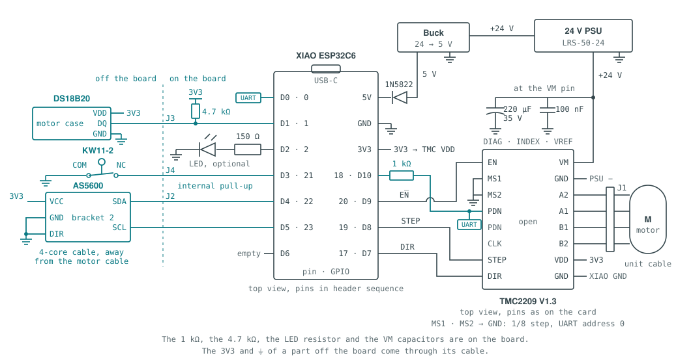
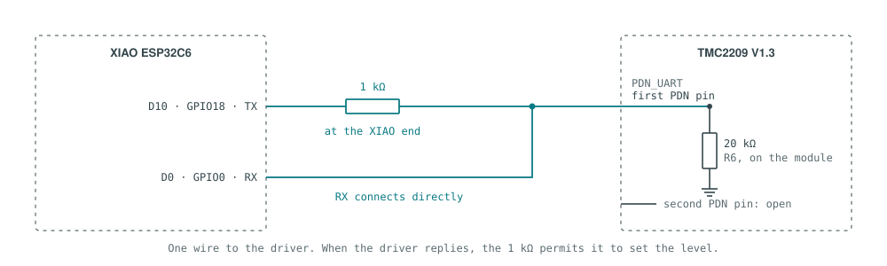

# Gearbox test rig guide

This guide tells you how to wire the test rig board, and how to build,
flash and use the test rig firmware.
The test rig measures the top speed and the wear of a gearbox unit. The
design is in the spec
[docs/superpowers/specs/2026-11-21-gearbox-test-rig-design.md](docs/superpowers/specs/2026-11-21-gearbox-test-rig-design.md)
(the master copy is issue #27).

The rig firmware is a separate PlatformIO env in this repository. It has
no Zigbee and no keypad. It uses the same `motion`, `ramp` and
`rf_switch` modules as the blind firmware.

## Status

This is the first version of the rig firmware (ticket #31). It has only
the serial console and the `move`, `stop` and `status` commands. The
driver UART, the encoder, the limit switch, MQTT and the test profiles
come in later tickets.

The driver is disabled after each move. Hold at idle stays off until the
firmware sets `IHOLD` through UART (ticket #33).

**Bench result, 2026-11-21.** On the present test board, with the
17HS4401 gearbox unit and no load, `move 24000 150` turned the output
one revolution. `move -24000 150` turned it back to the start mark.

Set Vref to 1.92 V before the first move. At 1.2 V, the gearbox unit
did not turn at 150 µs, and it only vibrated at 1000 µs. A free motor
turned correctly, so the board and the firmware were not the cause.
Also make sure that the 24 V supply is on: without VM, the firmware
reports each move as complete, but the motor does not turn.

**WARNING:** Do not hang a load on the rig with this version. The driver
is disabled between the moves, and the load can turn the gearbox
backwards.

## Wiring

This diagram shows the full rig board, on the pin map of the spec. The
parts in teal are new for the rig. The other parts are the same as on
the blind board.



This diagram shows the single-wire UART of the driver. D10 sends
through 1 kΩ, and D0 receives on the same wire:



**The HTML page is the master.** `docs/wiring/rig-wiring.html` has the
two diagrams, the XIAO header table, the connectors, the changes to the
present test board and the checks before power. Open it in a browser.
To change the wiring:

1. Change the HTML.
2. Extract the SVGs again:

   ```bash
   python3 tools/extract_wiring_svg.py docs/wiring/rig-wiring.html
   ```

3. Commit the HTML and the SVGs together.

The pin map is in three places: the spec, the HTML page, and
`src/rig_main.c` when the firmware uses the pin. If you change a pin,
change the three places. Then extract the SVGs again.

## Parts list

"Have" means that you have the part now. "Buy" means that you must get
it. "Check" means that you possibly have it: make sure before you order.

| Part | Quantity | Function | Status |
|---|---|---|---|
| Seeed XIAO ESP32C6 | 1 | Controller | Have |
| BIGTREETECH TMC2209 V1.3 | 1 | Stepper driver | Have |
| Gearbox unit with a 17HS4401 | 1 | Unit 1 | Have |
| Gearbox unit with a 42HS60-1504JA05-D20-03 | 1 | Unit 2 | Have |
| Motor cable for each unit, with a label | 2 | J1 to the motor. The two cables are not interchangeable. | Have |
| KW11-2 microswitch with a roller lever | 1 | Top limit switch | Have |
| 24 V PSU (LRS-50-24) | 1 | Power | Have |
| Buck regulator 24 → 5 V (Mini560 Pro) | 1 | 5 V for the XIAO | Have |
| 220 µF 35 V electrolytic capacitor | 1 | At the VM pin | Have |
| 100 nF ceramic capacitor (`K104K20X7RH5TL2`) | 1 | At the VM pin, optional | Have |
| 1N5822 Schottky diode | 1 | Buck 5 V to the XIAO 5V pin, against USB backfeed | Have (installed on the test board, 2026-11-21) |
| 4.7 kΩ resistor (`RS-C-4K7-5%-0.5W`) | 1 (+2) | DS18B20 pull-up. Add 2 for SDA and SCL if the AS5600 module has no pull-ups. | Have |
| 150 Ω resistor (`MF0204FTE52-150R`) and 3 mm LED (`L-7104SURC-E`) | 1 each | Status LED on D2, optional | Have |
| U.FL antenna, 2.4 GHz | 1 | Wi-Fi (ticket #36) | Have |
| 5 L water container (80 g empty) | 1 | Test load | Have |
| AS5600 module | 1 (+1 spare) | Angle of the spool tube, on bracket 2. It must operate at 3.3 V (VDD5V and VDD3V3 connected together). | Buy |
| Diametric magnet, 6 × 2.5 mm, N35 or stronger | 1 | In the end of the spool tube. Many AS5600 modules include one. The CAD sets the final size. | Buy |
| DS18B20, TO-92 or a probe in a metal tube | 1 | Motor case temperature | Buy |
| 1 kΩ resistor, 0.25 W | 1 | UART TX, D10 to the first PDN pin | Buy |
| JST XH 2.54 mm headers, housings and crimp contacts: 2-, 3- and 4-pin | 1 of each | J2, J3 and J4 | Buy |
| 4-core cable | 0.5 m | AS5600 to J2 | Buy |
| 2-core and 3-core cable | 1 m each | KW11-2 to J4, DS18B20 to J3 | Check |
| Braided cord, 2 mm (for example Dyneema), rated 20 kg or more | 3 m | Spool to the container | Buy |
| Cord stopper: a bead with a 2 mm hole, or a crimp ferrule | 2 | Pushes the KW11-2 lever at the top limit | Buy |
| M4 bolts, nuts and washers (the CAD sets the length) | 4 | Gearbox housing to bracket 1 | Buy |
| M2 screws and nuts | 2 | KW11-2 to the board | Buy |
| Thermal paste and heat-resistant tape | 1 | DS18B20 on the motor case | Check |
| Snap hook | 1 | Cord to the container handle | Check |
| Board, 300 × 1200 mm, and 2 clamps | 1 | The rig base on the work surface | Check |
| Soft pad (foam or a towel) | 1 | Under the container, in case it falls | Check |

The CAD work (ticket #30) sets the support bearing of bracket 2 and the
tube length. Add the bearing to this list when the CAD selects it.

## Build and flash

**CAUTION: Connect USB before the 24 V supply.** When 24 V is on, the
buck puts approximately 4.7 V on the USB VBUS line through the 1N5822.
A USB-C port on the Mac then does not start the connection, and the
board does not appear. This occurred on 2026-11-21 with the Mac
connected directly.

1. Disconnect the 24 V supply.
2. Connect the XIAO ESP32C6 of the rig board to the Mac with a USB-C cable.
3. If macOS asks "Allow accessory to connect?", click Allow.
4. Connect the 24 V supply.
5. Build the rig firmware, flash it, and open the serial monitor:

   ```bash
   pio run -e seeed_xiao_esp32c6_rig -t upload -t monitor
   ```

6. Make sure that the monitor shows the line `test rig ready`.

The env `seeed_xiao_esp32c6_rig` sets two build values:

- `FW_APP=rig` selects the rig source files in `src/CMakeLists.txt`.
- `RAMP_MIN_CRUISE_US=40u` sets the fastest step interval to 40 µs for
  the speed sweep. The blind keeps 60 µs. A build of the rig that
  does not get this flag stops with an error.

To put the blind firmware back on the board, flash the env
`seeed_xiao_esp32c6_zigbee`. Refer to [DEVELOPER_GUIDE.md](DEVELOPER_GUIDE.md).

## Serial commands

Type a command in the serial monitor. Then push the Enter key. The monitor
shows what you type (`monitor_echo = yes`).

| Command | Effect |
|---|---|
| `move <steps> <interval_us>` | Turn the motor by `<steps>` microsteps. A positive value turns in the + direction. A negative value turns in the − direction. `<interval_us>` is the step interval at cruise, from 40 to 1000 µs. |
| `stop` | Decelerate and stop the move. |
| `status` | Show the state (`idle` or `moving`) and the position in microsteps. |

The ramp is the same as on the blind: the first step is at 500 µs, and
the acceleration has 800 steps. At 1/8 microstep through the 1:15
reduction, one output revolution is 24 000 microsteps. The rig rejects a
move of more than 400 000 microsteps.

The words are case-sensitive. The rig rejects a command that is not
correct and tells you why.

## Cycle script

`tools/rig_cycle.py` runs back-and-forth cycles through the serial
console. Each cycle is one move forward and one move back. The script
stops at a move that is not complete, at a rejected command, or when the
position does not come back to the start.

1. Close the serial monitor. Only one program can use the port.
2. Run the script, for example 50 cycles of ±10 revolutions at 100 µs:

   ```bash
   ~/.platformio/penv/bin/python tools/rig_cycle.py --cycles 50 --revs 10 --interval 100
   ```

3. To stop, push Ctrl+C. The script sends `stop`.

The script rests 30 s after each move (`--pause`). The driver is
disabled during the rest, so the motor cools. With 2 s of rest, a
17HS4401 at 100 µs became too hot to hold after 7 cycles of ±10
revolutions.

The firmware has no feedback. The script cannot see a stall, so watch
the mark.

## Output

The rig writes each record as one line: the topic, a space, and a JSON
object. Later, the MQTT adapter (ticket #36) sends the same records to
the broker. The topics then also contain the unit, for example
`rig/<unit>/move` (ticket #33).

| Topic | When | Fields |
|---|---|---|
| `rig/status` | At each change of state, and for `status` | `state`, `position` |
| `rig/move` | At the end of each move | `from`, `target`, `end`, `interval_us`, `completed` |
| `rig/reply` | The answer to a command | `ok`, `text` |

An example session:

```text
move 24000 150
rig/status {"state":"moving","position":0}
rig/move {"from":0,"target":24000,"end":24000,"interval_us":150,"completed":true}
rig/status {"state":"idle","position":24000}
move 100 20
rig/reply {"ok":false,"text":"move: interval_us must be 40..1000"}
```

`completed` is `false` when `stop` stopped the move before the target.

## Host tests

The command parser, `rig_ctl` and the record text have host tests in
`test/test_rig_ctl/`. Run all the host tests:

```bash
pio test -e native
```
