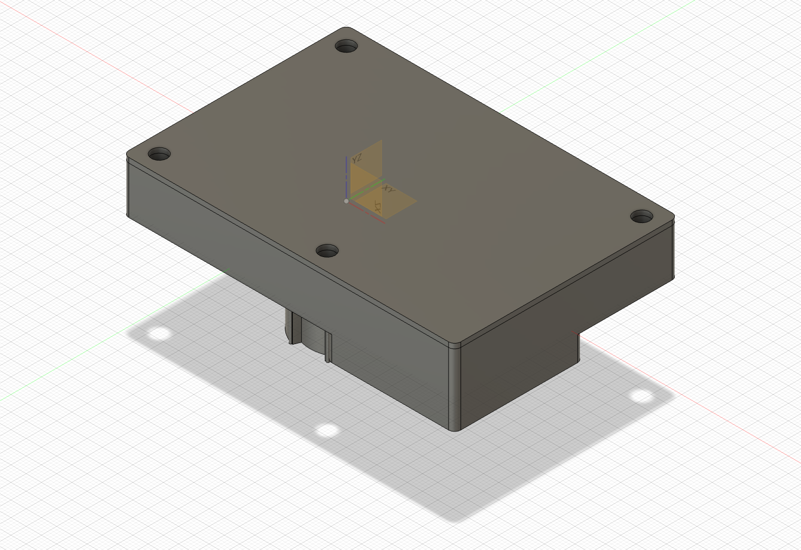
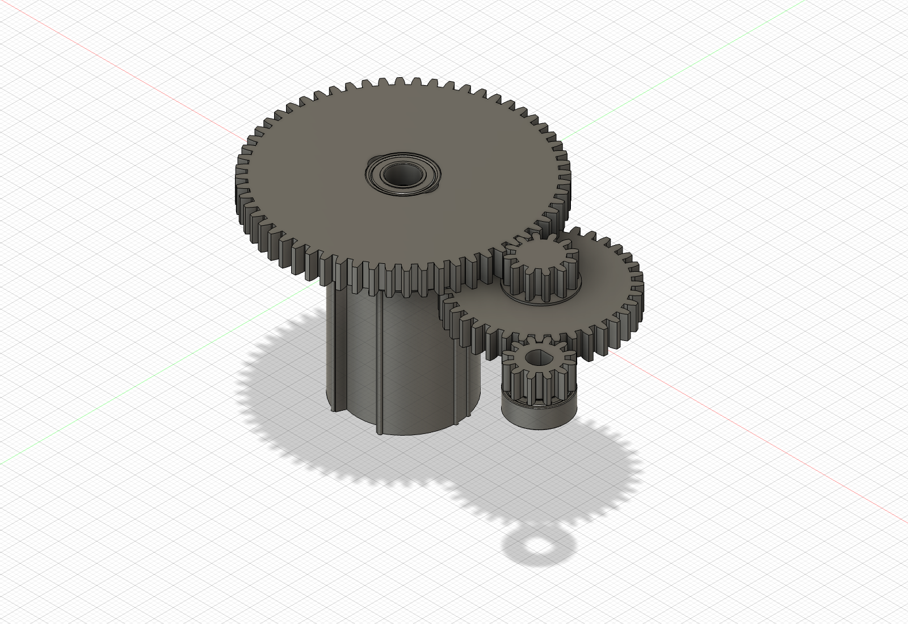

# Gearbox (1:15)

This is the 3D-printed spur-gear reduction between the stepper and the
roller tube. It replaces the old `Blinds 2.step` reference. The source of
truth is the Fusion design **Blinds gearbox assembly** in the Fusion
project `BlindsController2`. The STEP and the assembly `.f3d` were
exported on 2026-11-20 from version 17 of that design. The parts did not
change after version 15. Thus the STLs, the plates and the `.f3d` files
of the parts are the 2026-11-16 exports. All these exports use these
part versions: `gear housing` v13, `Gear Housing Lid` v6,
`Driven Gear 60 teeth` v6, `Idler Gear` v3, `Driver Gear` v1 and
`Blinds Shaft Attachment` v7.

## Gear train

The gear train has two stages of module 1 spur gears:

| Stage | Driving | Driven | Ratio | Centre distance |
|---|---|---|---|---|
| 1 | Driver gear, 12 T (motor shaft) | Idler gear, large wheel, 36 T | 3 : 1 | 24.0 mm |
| 2 | Idler gear, pinion, 12 T | Driven gear, 60 T | 5 : 1 | 36.0 mm |

The overall ratio is 3 × 5 = **15 : 1**. The step calculations of the
firmware use this 1:15 ratio (24 000 microsteps for each output
revolution at 1/8 microstep). The name of the "idler" is not correct. It
is a compound gear (36 T and 12 T on one body), not a true idler. The
tooth counts and the centre distances were measured from the geometry of
the model. The design has no user parameters, so no parameter table was
available.

## Motion

The Fusion assembly can move. The left housing is grounded. Each gear
has an as-built revolute joint about its own axis: `Rev Driver Gear`,
`Rev Idler Gear` and `Rev Driven Gear 60 teeth`. A rigid joint attaches
the shaft attachment to the driven gear. Rigid joints attach the lid and
the four bearings to the housing. Two motion links set the ratios:

| Motion link | Joint 1 | Joint 2 | Values |
|---|---|---|---|
| `Link driver-idler 3:1` | Rev Driver Gear | Rev Idler Gear | 360° : 120°, reversed |
| `Link idler-driven 5:1` | Rev Idler Gear | Rev Driven Gear 60 teeth | 360° : 72°, reversed |

To show the motion, use **Assemble → Drive Joints** on
`Rev Driver Gear`, or pull the driver gear. You can also make a
**Motion Study**. When the driver turns 30°, the idler turns 10° in the
opposite direction. The driven gear and the shaft attachment turn 2° in
the same direction as the driver. This is 15:1.

The gears were already meshed at rest. An interference check on the
three gears finds only tooth contact (0.01–0.05 mm³), at rest and with
the driver turned 30°. The same check finds 3.5 mm³ of overlap between
the shaft attachment and the hub of the driven gear at their current
positions. This check was done on version 15.

Versions 16 and 17 only turn the gear train through its joints. The
idler is 42° from its version 15 position, and the driven gear and the
shaft attachment are 63.6° from theirs. This is the 5:1 ratio of stage 2. The
shaft attachment has a rigid joint to the driven gear. Thus the 3.5 mm³
overlap does not change.

## Files

| Path | What it is |
|---|---|
| `blinds-gearbox-assembly.step` | The full assembly, with the bearings. The parts are in their assembled positions. Use it to look at the assembly, to do fit checks, or to open it in a different CAD tool. |
| `stl/*.stl` | One binary STL for each printed part. Each STL was exported at high mesh refinement, in millimetres. Each STL uses the coordinates of its part. Thus you must orient it in the slicer. |
| `fusion/<part>.f3d` | The Fusion design of each printed part, with its timeline. Use it to edit the part offline. |
| `fusion/blinds-gearbox-assembly.f3d` | The assembly design only. Its parts are **cross-references** to the Fusion cloud project. Thus the archive is not complete by itself. Edit the parts in the cloud project, or make a new assembly from the `.f3d` files of the parts. |
| `print/x2d-*.stl` | Print plates for the Bambu Lab X2D. The parts are already placed and oriented (refer to [Printing](#printing-bambu-lab-x2d)). |
| `renders/` | Viewport captures from the top and the bottom. They show the closed assembly, and the gear train with the housing and the lid hidden. |

## Parts

### Printed

| Part | STL | Notes |
|---|---|---|
| Gear housing, left | `gear-housing-left.stl` | 108.9 × 73.4 × 23.5 mm. The assembly shows this housing. |
| Gear housing lid, left | `gear-housing-lid-left.stl` | Fits the left housing. |
| Gear housing, right | `gear-housing-right.stl` | An exact mirror of the left housing. |
| Gear housing lid, right | `gear-housing-lid-right.stl` | An exact mirror of the left lid. Fits the right housing. |
| Driver gear, 12 T | `driver-gear-12t.stl` | Fits on the motor shaft. |
| Idler gear, 36 T + 12 T | `idler-gear-36t-12t.stl` | The compound middle stage. |
| Driven gear, 60 T | `driven-gear-60t.stl` | The output stage. |
| Shaft attachment | `shaft-attachment.stl` | A splined spigot, Ø 31.5 × 22.6 mm, that turns the roller tube. It is on the axis of the driven gear, below the output bearing. |

### Bearings (bought)

| Qty | Part | Size (bore × OD × width) | Where |
|---|---|---|---|
| 1 | 61804-2RS1 | 20 × 32 × 7 mm | Output: the hub of the driven gear |
| 3 | 628/7-2Z | 8 × 14 × 5 mm | One on each of these: the driver gear, the idler gear and the top of the driven gear |

## Printing (Bambu Lab X2D)

The `print/` folder has three plate files. Each file is one STL that has
all its parts already oriented, with 10 mm between the parts. Each plate
is at the centre of the 256 × 256 mm plate of the X2D. Each plate fits in
235 × 250 mm. Thus it also fits in the narrower dual-nozzle print area
(235.5 mm wide).

| File | Parts | Footprint × height |
|---|---|---|
| `x2d-gears.stl` | Driven gear 60 T, idler 36/12 T, shaft attachment, driver gear 12 T: the parts for one gearbox | 175.5 × 62.0 × 22.6 mm |
| `x2d-housing-left.stl` | Left housing + left lid | 108.9 × 156.7 × 23.5 mm |
| `x2d-housing-right.stl` | Right housing + right lid | 108.9 × 156.7 × 23.5 mm |

Bambu Studio imports each file as one object. To use different settings
for each part, or to move or copy a part, use **Split → To objects**.

The orientation of each part was selected from a score of the six
axis-aligned orientations. The score uses the bed-contact area and the
overhang area. The overhang area is the down-facing area that is steeper
than 45° and is not on the bed.

- **Lid**: print it with its flat outer face down. It does not need
  supports.
- **Driver gear, driven gear**: print them with their large flat end
  down. They need almost no supports.
- **Shaft attachment**: print it upside down from its STL, with the flat
  end that is toward the gear down. This orientation gives the best use
  of support material. Approximately 160 mm² of the part touches the
  bed. The slicer must support three ledges: approximately 205 mm² at
  0.5 mm, 86 mm² at 1.0 mm and 240 mm² at 3.1 mm above the bed.
- **Idler gear**: print it with its bearing hub down. The bottom of the
  36 T wheel is 1.5 mm above the bed (approximately 780 mm² of
  overhang). Thus it needs support. *Support on build plate only* is
  sufficient. Do not print it with the pinion down. That orientation
  puts the wheel 6.5 mm above a base of 108 mm², which is worse.
- **Housing**: print it with the floor down, as designed. The
  motor-mount boss is the lowest point. The main floor is 8 mm above the
  bed (approximately 5100 mm²). Thus it needs *support on build plate
  only* under the floor. All the other orientations were worse. With the
  open side down, the full floor is a bridge. On its side, the part has
  large ceilings 60–70 mm above the bed.

`print/make_plates.py` makes the plates from the STLs of the parts. It
only moves the parts. The exception is the parts in its `FLIP` set (the
shaft attachment), which it turns 180° about X. This is a rotation, not
a mirror. Thus each hand stays the same. When the STLs of the parts
change, run the script again
(`python3 hardware/gearbox/print/make_plates.py`).

## Left and right hands

The housing and the lid each have a left hand and a right hand. Each
pair is an exact mirror image. Print a matched pair: two left parts or
two right parts. The gears, the bearings and the shaft attachment are
the same for the two hands.

In Fusion, the two designs have the same structure. Each hand is its own
component, `Left` and `Right`. In the `gear housing` design, these
components are under `Component1`. In the lid design, they are at the
root. The assembly shows the left hand and hides `Right` in the two
designs.

The housing mirror was checked on the B-rep. The two hands have the same
volume, area and face count. 300 of 300 random sample points agree under
the mirror.

## Re-exporting

If the Fusion design changes, export again from **Blinds gearbox
assembly**:

- The STEP comes from the root component. Thus the hidden `Right` bodies
  are not in it.
- Each STL comes from the single body of its part. Export it as binary,
  with custom refinement: surface deviation 0.028 mm and normal
  deviation 3°. Do not use the **High** preset. In Fusion 2706.1,
  **High** uses a normal deviation of 10°. It gave approximately half
  the triangles of the committed STLs.
- Each `.f3d` of a part comes from
  `exportManager.createFusionArchiveExportOptions(path, occurrence.component)`.

Then change the version number and the date at the top of this file.
